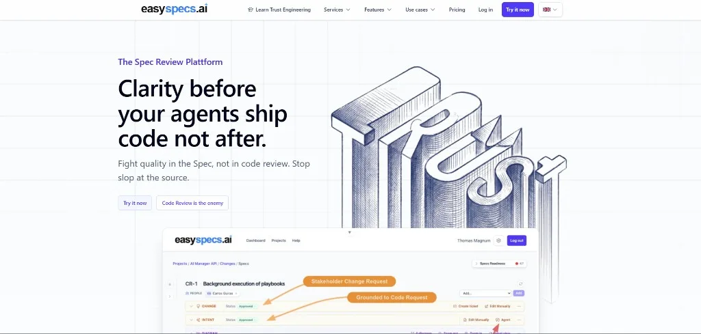
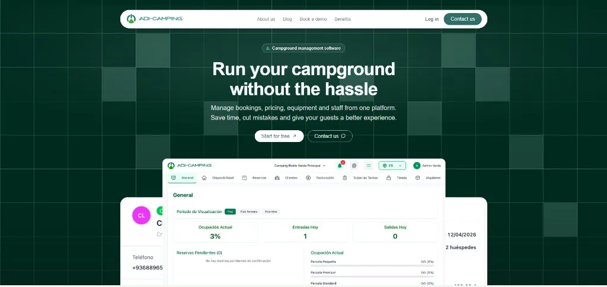
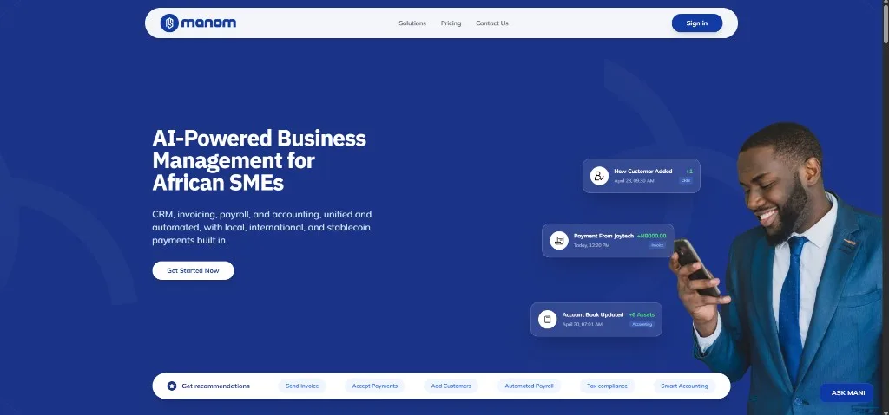
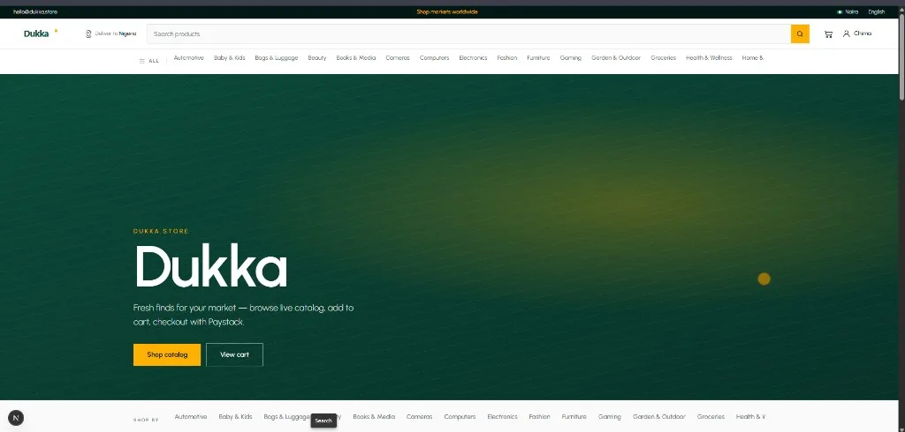
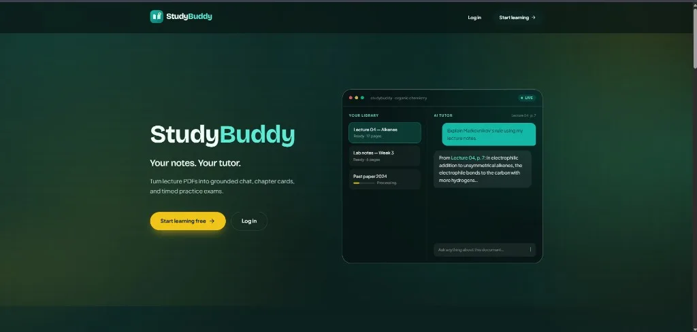

# Chima Ojimma

**Backend Engineer** - Building production systems with real-time data pipelines, AI orchestration, and enterprise SaaS.

[Portfolio](https://chima-peter.vercel.app/) · [LinkedIn](https://linkedin.com/in/chimaojimma) · [Email](mailto:chimaojimma@gmail.com) · [Resume](https://chima-peter.vercel.app/Chima_Ojimma_Resume.pdf)

---

## About

Backend engineer with 4+ years architecting production-grade systems, distributed services, and AI-powered applications across fintech, SaaS, and developer tooling.

I work most at the intersection of reliability and product impact: clear APIs, durable pipelines, and infrastructure you can operate without guesswork. Recent focus spans developer tooling (**EasySpecs**), camping SaaS (**ADI Camping**), fintech (**ManomPay**), and commerce (**Dukka**).

---

## Tech Stack

| | |
|---|---|
| **Languages** | TypeScript · Python · JavaScript |
| **Frontend** | React · Next.js · Vue 3 · Tailwind CSS · Framer Motion |
| **Backend** | FastAPI · NestJS · Node.js · Express · Django |
| **AI / ML** | LangChain · LangGraph · OpenAI · Gemini · Groq · Mistral |
| **Databases** | PostgreSQL · Redis · Neo4j · Prisma · Elasticsearch · Supabase |
| **Infrastructure** | Docker · AWS · Celery · BullMQ · Pulumi · Sentry · Vercel |
| **Testing** | Jest · Playwright · Vitest · Pytest |
| **Other** | Stripe · Paystack · Twilio · Cloudinary · Telegram API |

---

## Selected Work

### [EasySpecs.ai](https://easyspecs.ai) - [Extension](https://open-vsx.org/extension/easyspecs/easyspecs-ai) - [CLI](https://www.npmjs.com/package/@gluecharm-lab/easyspecs-cli)

**Problem:** Writing software requirements is tedious and often skipped, and docs that do exist drift away from the codebase.

**Solution:** Built a web app, CLI, and IDE extension that keep specs beside the code - with AI help to draft and update them, Jira sync, and cloud sharing across the team.

`Vue 3` `TypeScript` `Vite` `Pinia` `Node.js` `FastAPI` `Neo4j` `PostgreSQL` `Supabase` `Pulumi` `AWS`

---

### [ADI Camping](https://adicamping.com)

**Problem:** Campground operators juggled bookings by hand across properties, which led to double bookings, missed payments, and gaps with guests.

**Solution:** Built one platform for campground staff and guests: bookings, payments, messaging, maps, and compliance - plus a WordPress plugin so marketing sites can take reservations.

`Vue 3` `Tailwind` `Supabase` `Stripe` `Twilio` `Gemini` `Vertex AI` `Pulumi` `WordPress`

---

### [ManomPay](https://manomsolutions.com)

**Problem:** SMEs and freelancers split invoices, payments, and expenses across tools, so cash flow was hard to see.

**Solution:** Built the NestJS backend for invoices, payments, expenses, and cash-flow - with Paystack and crypto checkout, background jobs, and automatic reminders.

`NestJS` `TypeScript` `Prisma` `PostgreSQL` `Redis` `Bull` `Paystack`

---

### Dukka - [Backend](https://github.com/Chima-Peter/Dukka) · [Storefront](https://github.com/Chima-Peter/dukka_store)

**Problem:** Selling across African markets needs local catalogs, currency pricing, and reliable checkout - not a one-size-fits-all store.

**Solution:** Built an API and storefront for multi-market shopping: local catalogs and prices, cart and checkout, payments, and order fulfillment for customers and staff.

`NestJS` `Prisma` `PostgreSQL` `BullMQ` `Redis` `Paystack` `Next.js` `RTK Query` `Tailwind` `Framer Motion`

---

### StudyBuddy - [Backend](https://github.com/Chima-Peter/study_buddy) · [Frontend](https://github.com/Chima-Peter/study_buddy_app)

**Problem:** Students bounce between notes, tutoring, and quizzes that aren’t tied to their own course materials.

**Solution:** Built a study app where students upload their notes, chat with a tutor grounded in those notes, and get study cards and practice quizzes generated for them.

`Python` `FastAPI` `Supabase` `Redis` `RabbitMQ` `Elasticsearch` `LangGraph` `Gemini` `Docker`

---

### System Manager API

**Problem:** GlueCharm and EasySpecs needed one backend for teams, workspaces, specs, access control, and AI.

**Solution:** Built the shared backend for GlueCharm and EasySpecs: teams, workspaces, specs, Jira sync, and AI that routes across multiple providers. API-only - no public UI.

`FastAPI` `PostgreSQL` `Neo4j` `Redis` `Celery` `Supabase` `LangChain` `AWS` `Pulumi`

---

### [Tales of Logistics](https://talesoflogistics.com)

**Problem:** Needed a public place to publish podcasts, videos, and articles with basic moderation and contact forms.

**Solution:** Built the public site for the podcast and learning brand - episodes, videos, short reads, and contact forms - with moderated publishing and no separate admin backend.

`Next.js` `React` `TypeScript` `PostgreSQL` `Nodemailer` `Cloudinary` `Tailwind` `Framer Motion`

---

### Funding vs OI Divergence Screener - [Context Protocol](https://ctxprotocol.com)

**Problem:** Spotting funding and open-interest setups across exchanges by hand is slow and easy to miss.

**Solution:** Built a tool that watches funding and open interest across major exchanges, ranks opportunities, and explains the signal so traders or AI agents can use it. API-only.

`TypeScript` `Node.js` `Redis` `MCP Protocol`

---

## Elsewhere

[Portfolio](https://chima-peter.vercel.app/) · [GitHub](https://github.com/chima-peter) · [LinkedIn](https://linkedin.com/in/chimaojimma) · [Resume](https://chima-peter.vercel.app/Chima_Ojimma_Resume.pdf) · [chimaojimma@gmail.com](mailto:chimaojimma@gmail.com)
